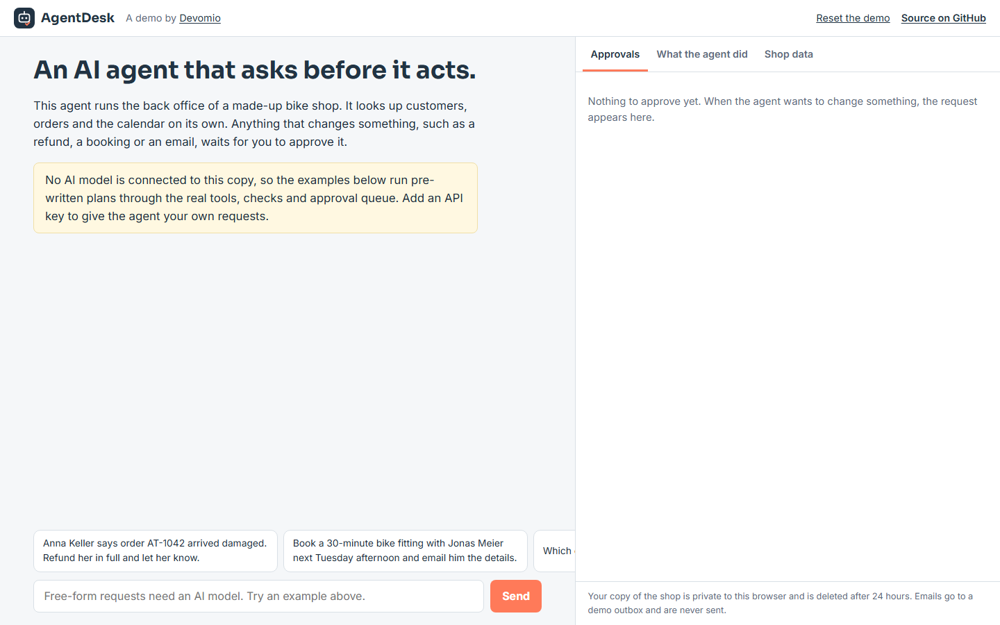

# AgentDesk

**Live demo: [agentdesk.devomio.com](https://agentdesk.devomio.com/)**



An AI agent that asks before it acts.

AgentDesk runs the back office of a fictional bike shop. Ask it in plain language to deal with a
damaged order, book an appointment or chase a customer. It looks up customers, orders and the
calendar on its own. Anything that changes something (a refund, a booking, an email) becomes a
request that a person approves or rejects. Nothing happens until someone presses Approve.

Built by [Devomio](https://devomio.com/) as an open example of a business AI agent with the
controls companies ask for: approval steps, server-side guard rails and a full activity log.

## What it does

- **Plans and uses tools on its own.** Seven tools: four that read (search customers, get an order,
  list orders, check the calendar) and three that write (send an email, book an appointment, issue
  a refund). The agent decides which to call and in what order.
- **Writes wait for a person.** A write tool never changes data when the model calls it. It creates
  an approval request showing exactly what will happen: the full email, the time slot, the amount.
  The change runs only on Approve, and the agent is told the outcome on its next turn.
- **Guard rails on the server, not in the prompt.** A refund cannot exceed what is still refundable,
  emails only go to existing customers, bookings must be in opening hours and free. These checks run
  when the request is created and again when it is approved, in case the data changed in between.
  Refused calls go back to the model as errors, so it can correct itself.
- **Everything is logged.** The activity panel lists every tool call with its input and result.
- **Works without an API key.** Four example tasks run pre-written plans through the same real
  tools, guard rails and approval queue, so the mechanics can be tried before connecting a model.
- **Safe to expose publicly.** Each visitor gets a private copy of the shop, deleted after 24 hours.
  Emails go to a demo outbox and are never sent. Daily limits per visitor and per site.

## How it works

```
request  ->  Claude with 7 tools  ->  read tools run   ->  results back to Claude  ->  ... (bounded loop)
                                  ->  write tools      ->  validated, queued as an Action
reply    ->  "Waiting for your approval: ..."
Approve  ->  validated again, executed  ->  update passed to the agent on the next turn
```

| File | Role |
|---|---|
| `agent/services/tools.py` | Tool definitions (strict JSON schemas), read handlers, write validation and execution |
| `agent/services/runner.py` | The agent loop with Claude, the system prompt, and the scripted examples |
| `agent/services/demo_data.py` | The fictional shop, with dates relative to today |
| `agent/views.py` | The JSON API: chat, state, approve or reject, reset |
| `agent/static/agent/app.js` | The chat, approval queue, activity log and data panels |

The loop is written by hand rather than with an SDK runner, so the approval rule is visible in one
place: `tools.run()` executes read tools and turns every write into a pending `Action`.

## Run it locally

Requires Python 3.12 or newer.

```bash
git clone https://github.com/aidevmonir-dev/agentdesk.git
cd agentdesk
python -m venv .venv
.venv/bin/pip install -r requirements.txt        # Windows: .venv\Scripts\pip
cp .env.example .env                             # set DEBUG=1 and your ANTHROPIC_API_KEY
.venv/bin/python manage.py migrate
.venv/bin/python manage.py runserver
```

Open http://127.0.0.1:8000/ and try an example task, or type your own request.

### With Docker

```bash
cp .env.example .env      # set SECRET_KEY, ANTHROPIC_API_KEY, ALLOWED_HOSTS=localhost
docker compose up --build
```

## Configuration

All settings come from environment variables or a `.env` file. See [.env.example](.env.example).

| Variable | Default | Purpose |
|---|---|---|
| `ANTHROPIC_API_KEY` | none | Claude API key. Empty means only the scripted examples run. |
| `ANTHROPIC_MODEL` | `claude-opus-5-5` | Any current Claude model with tool use. |
| `ANTHROPIC_EFFORT` | `medium` | How much reasoning the agent spends per step. |
| `MAX_TOOL_ROUNDS` | `8` | Most tool rounds the agent may take for one request. |
| `MESSAGES_PER_IP_PER_DAY` | `30` | Daily limit per visitor. |
| `MESSAGES_PER_DAY_TOTAL` | `300` | Daily limit for the whole site. |
| `RETENTION_HOURS` | `24` | How long a visitor's copy of the shop is kept. |
| `TIME_ZONE` | `Europe/Zurich` | The shop's local time, used for the calendar. |

## Tests

```bash
DEBUG=1 python manage.py test
```

The tests cover every tool, every guard rail, re-validation at approval time, the agent loop
(parallel tool results, error results, the round limit, approval updates in the history), the
scripted examples, approve and reject, session privacy, limits and expiry. The Claude API is
replaced by a scripted fake client, so they run offline and cost nothing.

## Adapting it to a real business

Replace the demo models and the handlers in `tools.py` with calls to your own systems: a shop
backend, a CRM, a booking tool, an email provider. Keep the split: reads run, writes queue. Typical
next steps are approval rules by amount or role, Slack or email notifications for new requests,
and single sign-on for staff.

## Need this for your business?

Devomio builds production agents connected to your real systems, with approval rules, audit logs
and hosting in the EU or Switzerland. See [devomio.com](https://devomio.com/) or write to
hello@devomio.com.

## Licence

MIT. See [LICENSE](LICENSE). The shop, customers and orders are fictional.
